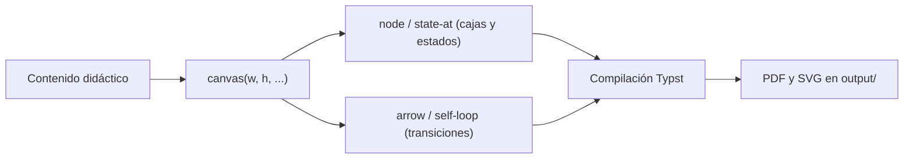

# Guía de Estilos Typst para Láminas Didácticas (estilos_typst.md)

Este documento es la **fuente única de verdad** para el color, la tipografía, la composición y la compilación de las láminas didácticas escritas en Typst dentro del repositorio. Toda lámina nueva en `src/<Materia>/` debe reutilizar los valores aquí definidos en lugar de inventar una paleta propia.

---

## 1. Alcance y principios

| Principio | Aplicación en las láminas Typst |
|:---|:---|
| **Fuente única de verdad** | Los colores, tamaños y componentes se copian de este documento; no se improvisan valores por archivo. |
| **Formato de impresión** | Hoja **carta (US Letter)** por omisión; cualquier otra medida debe declararse en el comentario de cabecera del `.typ`. |
| **Vectorial y autónomo** | Diagramas nativos (`curve`, `polygon`, `block`); sin paquetes externos obligatorios ni imágenes rasterizadas. |
| **Alta densidad de señal** | Tarjetas autocontenidas con título, insignia, cuerpo y nota; sin párrafos redundantes. |
| **Trazabilidad** | Encabezado comentado con materia, formato y fuente; pie institucional con el documento origen. |

---

## 2. Formato de papel y márgenes

| Parámetro | Valor estándar (carta) | Excepción autorizada |
|:---|:---|:---|
| Papel | `paper: "us-letter"` = 215,9 mm × 279,4 mm | Láminas panorámicas: `width: 350mm, height: auto` (p. ej. [`src/VHDL/algebra_boole.typ`](file:///G:/REPOSITORIOS%20GITHUB/RECURSOS/src/VHDL/algebra_boole.typ)) |
| Márgenes | `x: 12mm`, `top: 10mm`, `bottom: 12mm` | Panorámicas: `x: 14mm`, `top: 12mm`, `bottom: 12mm` |
| Fondo de hoja | `#f8fafc` (pizarra muy claro) | `#ffffff` si el destino es fotocopia de alto contraste |
| Ancho útil | 191,9 mm | 322 mm en panorámicas |
| Pie de página | `context` con `counter(page).display()` y `counter(page).final().first()` | — |

```typst
#set page(
  paper: "us-letter",
  margin: (x: 12mm, top: 10mm, bottom: 12mm),
  fill: rgb("#f8fafc"),
  footer: context align(center, text(
    size: 7.2pt,
    fill: rgb("#94a3b8"),
    [Lámina · Materia · pág. #counter(page).display() de #counter(page).final().first()],
  )),
)
```

---

## 3. Paleta cromática didáctica

Cada color tiene un **significado pedagógico fijo**; no se usa un color para dos conceptos distintos dentro de la misma materia.

### 3.1 Colores semánticos (variables de estilo)

| Variable | Hex | Significado didáctico | Uso típico |
|:---|:---|:---|:---|
| `col-var` | `#1d4ed8` | 🔵 Azul real | Variables, estados, funciones |
| `col-num` | `#dc2626` | 🔴 Rojo carmesí | Números, constantes, salidas |
| `col-neg` | `#7c3aed` | 🟣 Púrpura | Negación, registro de estado |
| `col-op` | `#059669` | 🟢 Verde esmeralda | Operadores, lógica combinatoria |
| `col-head` | `#0f172a` | 🔵 Marino oscuro | Títulos principales |
| `col-sky` | `#0284c7` | 🩵 Azul cielo | Entradas del sistema |
| `col-amber` | `#d97706` | 🟠 Ámbar | Lógica de salida |
| `col-slate` | `#475569` | ⚫ Pizarra | Reloj, reset, anotaciones |

### 3.2 Neutros y superficies

| Hex | Función | Aplicación |
|:---|:---|:---|
| `#ffffff` | Superficie de tarjeta | Fondo del cuerpo y de las cajas de proceso |
| `#f8fafc` | Fondo de hoja / fila alterna | `page(fill:)` y cebreado de tablas |
| `#f1f5f9` | Cabecera de tabla | Fila 0 de `styled-table` |
| `#e2e8f0` | Borde suave | Separadores de fila, contornos de tarjeta |
| `#cbd5e1` | Separador medio | Línea de pie, contornos de nota |
| `#94a3b8` | Texto de pie | Créditos, numeración |
| `#64748b` | Texto secundario | Subtítulos y leyendas |
| `#475569` | Texto terciario | Subtítulos dentro de cajas y notas |

### 3.3 Regla de derivación de matices

Los matices de cada tarjeta se obtienen **siempre** por transformación del color de marca, nunca con valores nuevos:

```typst
brand-color.lighten(92%)   // fondo de la banda de título
brand-color.lighten(75%)   // fondo de la insignia (badge)
brand-color.lighten(60%)   // borde de la tarjeta
brand-color.darken(25%)    // texto del título
brand-color.darken(35%)    // texto de la insignia
```

### 3.4 Colores por bloque funcional (FSM y lógica digital)

| Bloque | Color de marca | Fondo del nodo |
|:---|:---|:---|
| Entradas | `#0284c7` | `#e0f2fe` |
| Próximo estado `δ` | `#059669` | `#ecfdf5` |
| Registro de estado | `#7c3aed` | `#f5f3ff` |
| Lógica de salida `λ` | `#d97706` | `#fff7ed` |
| Salidas | `#dc2626` | `#fef2f2` |
| Reloj y reset | `#475569` | `#f1f5f9` |
| Notas de refuerzo | `#166534` sobre `#f0fdf4` | borde `#86efac` |

---

## 4. Tipografía y jerarquía

| Elemento | Fuente | Tamaño | Color |
|:---|:---|:---:|:---|
| Cuerpo de texto | `Segoe UI`, `Calibri`, `Arial` | 9 pt | `#0f172a` |
| Título de lámina (H1 visual) | igual | 18,5 pt, negrita | `col-head` |
| Subtítulo de lámina | igual | 9,6 pt | `#64748b` |
| Título de tarjeta | igual | 10,4 pt, negrita | `darken(25%)` de la marca |
| Insignia de tarjeta | igual | 7,8 pt, negrita | `darken(35%)` de la marca |
| Celdas de tabla | igual | 8,3 pt | `#0f172a` |
| Encabezado de tabla | igual | 8,4 pt, negrita | `#1e293b` |
| Código en bloque | `Consolas`, `Courier New` | 7,1 pt | por token, ver §7.2 |
| Código en línea | `Consolas`, `Courier New` | 0,95 em | por token, ver §7.2 |
| Pie institucional | igual | 7,6 pt | `#94a3b8` |

```typst
#set text(
  font: ("Segoe UI", "Calibri", "DejaVu Sans", "Arial"),
  size: 9pt,
  fill: rgb("#0f172a"),
  lang: "es",
)
// El código no usa un color único: se resalta por token (ver §7.2)
#show raw: it => if it.block { code-highlight(it.text) } else { code-highlight(it.text, size: 0.95em) }
```

---

## 5. Componentes reutilizables

| Componente | Firma | Función |
|:---|:---|:---|
| `card` | `card(title, badge-text, brand-color, body)` | Tarjeta con banda de título, insignia y cuerpo; `breakable: false` |
| `styled-table` | `styled-table(col-widths, headers, ..rows)` | Tabla cebreada con cabecera destacada |
| `canvas` | `canvas(w, h, body)` | Lienzo de coordenadas absolutas centrado |
| `node` | `node(x, y, w, h, fill, border, title, sub)` | Caja de proceso con título y subtítulo |
| `arrow` | `arrow(pts, color, ang: 0deg, dashed: false)` | Polilínea ortogonal con cabeza de flecha |
| `arrowhead` | `arrowhead(x, y, ang, color)` | Triángulo de punta calculado por trigonometría |
| `state-at` | `state-at(cx, cy, name, out, color)` | Estado circular con nombre y salida |
| `self-loop` | `self-loop(cx, cy, color)` | Auto-transición en parábola simétrica, punta a la izquierda |
| `lbl` | `lbl(x, y, body, size, fill, bg)` | Etiqueta de transición con respaldo opcional |
| `code-highlight` | `code-highlight(code, size: 7.1pt)` | Resaltado de sintaxis por token (ver §7.2) |

### 5.1 Tarjeta canónica

```typst
#let card(title, badge-text, brand-color, body) = block(
  width: 100%,
  stroke: 1pt + brand-color.lighten(60%),
  radius: 7pt,
  fill: rgb("#ffffff"),
  inset: 0pt,
  clip: true,
  breakable: false,
  [
    #block(width: 100%, fill: brand-color.lighten(92%), inset: (x: 12pt, y: 6.5pt),
      stroke: (bottom: 1pt + brand-color.lighten(60%)),
      grid(columns: (1fr, auto), align: (left + horizon, right + horizon),
        text(fill: brand-color.darken(25%), weight: "bold", size: 10.4pt, title),
        box(fill: brand-color.lighten(75%), radius: 4pt, inset: (x: 6pt, y: 2.5pt),
          text(fill: brand-color.darken(35%), size: 7.8pt, weight: "bold", badge-text))))
    #block(width: 100%, inset: (x: 8pt, y: 7pt), body)
  ]
)
```

> [!IMPORTANT]
> `breakable: false` es obligatorio en `card`: impide que una tarjeta se parta entre dos páginas y deje títulos huérfanos al imprimir.

### 5.2 Tabla canónica

```typst
#let styled-table(col-widths, headers, ..rows) = table(
  columns: col-widths,
  stroke: (x, y) => if y == 0 { (bottom: 1.5pt + rgb("#94a3b8")) } else { (bottom: 0.5pt + rgb("#e2e8f0")) },
  fill: (col, row) => if row == 0 { rgb("#f1f5f9") } else if calc.even(row) { rgb("#f8fafc") } else { rgb("#ffffff") },
  align: (col, row) => if row == 0 { center + horizon } else if col == 0 { left + horizon } else { center + horizon },
  inset: (x: 5pt, y: 4.2pt),
  ..headers.map(h => text(weight: "bold", size: 8.4pt, fill: rgb("#1e293b"), h)),
  ..rows.pos().map(c => if type(c) == content { c } else { text(size: 8.3pt, c) }),
)
```

---

## 6. Diagramación vectorial nativa

Los diagramas se dibujan con primitivas nativas de Typst sobre un lienzo de **coordenadas absolutas en milímetros**. Esto garantiza compilación sin red, salida vectorial y posiciones deterministas.



### 6.1 Convención de ángulos

| Ángulo | Dirección de la punta | Uso |
|:---:|:---|:---|
| `0deg` | Derecha (+x) | Avance del flujo |
| `90deg` | Abajo (+y) | Descenso o retorno desde el borde inferior |
| `180deg` | Izquierda (−x) | Realimentación horizontal |
| `-90deg` | Arriba (−y) | Entrada a un bloque por su borde inferior |

La cabeza de flecha se calcula, no se rota con `rotate(origin:)` —esa función solo acepta alineaciones—, de modo que la punta queda exactamente en el punto final de la polilínea:

```typst
#let arrowhead(x, y, ang, color, size: 4.6pt, half: 2.4pt) = {
  let a = ang.rad()
  let ux = calc.cos(a) * size
  let uy = calc.sin(a) * size
  let px = -calc.sin(a) * half
  let py = calc.cos(a) * half
  place(dx: x, dy: y, polygon(fill: color, (0pt, 0pt), (-ux + px, -uy + py), (-ux - px, -uy - py)))
}
```

### 6.2 Polilínea con retorno ortogonal

```typst
#arrow(((111mm, 24mm), (111mm, 31mm), (57mm, 31mm), (57mm, 24mm)), col-neg, ang: -90deg)
```

### 6.3 Auto-transición

El lazo de un estado es una **parábola simétrica** respecto de la vertical que pasa por el centro del círculo: nace a la derecha, se eleva sobre el estado y reingresa por la izquierda con la punta hacia abajo, de modo que se lee como «permanece aquí». Los dos puntos de control comparten altura, lo que garantiza simetría exacta y tangentes verticales en ambos extremos.

```typst
#let self-loop(cx, cy, color, w: 5.2mm, dIn: 8.4mm, rise: 7mm) = {
  let y0 = cy - dIn
  place(dx: cx - w, dy: y0, curve(
    stroke: 1pt + color,
    curve.move((2 * w, 0pt)),
    curve.cubic((2 * w, -rise), (0pt, -rise), (0pt, 0pt)),
  ))
  arrowhead(cx - w, y0, 90deg, color)   // punta a la izquierda, hacia abajo
}
```

| Parámetro | Valor | Efecto |
|:---|:---:|:---|
| `w` | 5,2 mm | Semiancho: los extremos quedan en `cx ± w` |
| `dIn` | 8,4 mm | Altura de los extremos sobre el centro (con radio 9 mm quedan 0,9 mm fuera de la circunferencia) |
| `rise` | 7 mm | Altura de los puntos de control; el vértice queda a `0,75 · rise` sobre los extremos |

> [!IMPORTANT]
> Queda prohibido construir diagramas con flechas de texto plano (`->`, `-->`, `==>`, `|`) o cajas ASCII, tanto en Typst como en Markdown, conforme a `AGENTS.md` §5.7 y §9.6.

---

## 7. Color didáctico de expresiones y código

### 7.1 Expresiones matemáticas

Las ecuaciones heredan la semántica de la paleta: números en rojo, operadores en verde, negaciones en púrpura.

```typst
#show math.overline: set text(fill: col-neg)
#show math.equation: it => {
  show regex("[01]"): m => text(fill: col-num, weight: "bold", m.text)
  show regex("[+⊕⊙\u{22c5}\u{00b7}]"): m => text(fill: col-op, weight: "bold", m.text)
  it
}
```

### 7.2 Resaltado de sintaxis del código

Todo fragmento de código —en línea o en bloque— se colorea **por token** con la paleta didáctica, para que el lector distinga de un vistazo la estructura del lenguaje. La misma función `code-highlight` se aplica a los dos formatos mediante un único `#show raw`.

| Categoría | Color | Hex | Estilo | Ejemplos |
|:---|:---|:---|:---|:---|
| Palabra clave | 🟣 Púrpura | `#7c3aed` | negrita | `entity`, `architecture`, `process`, `if`, `case`, `when`, `rising_edge` |
| Tipo o biblioteca | 🩵 Cielo | `#0284c7` | negrita | `ieee`, `std_logic`, `std_logic_1164`, `estado_t` |
| Variable / señal | 🔵 Azul | `#1d4ed8` | normal | `estado`, `prox_estado`, `clk`, `rst`, `x`, `y` |
| Número o bit | 🔴 Rojo | `#dc2626` | negrita | `'1'`, `'0'`, `10` |
| Cadena de texto | 🟠 Ámbar | `#d97706` | normal | `"texto"` |
| Comentario | ⚫ Pizarra | `#64748b` | itálica | `-- Proceso 1: registro de estado` |
| Operador / puntuación | ⚫ Pizarra | `#475569` | normal | `<=`, `=>`, `(`, `)`, `;`, `:` |

**Reglas obligatorias del resaltado:**

1. **Sin verde oscuro ni café.** Los comentarios van en pizarra itálica y los literales de cadena en ámbar; ningún token usa marrones ni verdes apagados que se confundan con el fondo.
2. **Una sola paleta para código y ecuaciones.** Las variables del código son azul `col-var` y los literales son rojo `col-num`, igual que en las expresiones matemáticas.
3. **Indentación exacta.** Cada espacio se emite como `U+00A0` (espacio no separable), porque Typst colapsa los espacios ordinarios y rompería la alineación del código.
4. **Todo `raw` se resalta.** Un único `#show raw` sustituye el fondo gris por defecto de Typst y cubre bloques y fragmentos en línea; no se admiten dos estilos de código en una misma lámina.
5. **Tokenizador léxico, no parser.** La prioridad se decide por la posición del primer acierto y, en empate, por el orden de la tabla: el comentario siempre gana al resto de la línea.

```typst
#let code-font = ("Cascadia Mono", "Consolas", "Courier New", "DejaVu Sans Mono")

#let code-theme = (
  comment: rgb("#64748b"), // Pizarra -> comentarios (-- ...)
  keyword: rgb("#7c3aed"), // Púrpura -> palabras clave del lenguaje
  storage: rgb("#0284c7"), // Cielo   -> tipos y bibliotecas
  ident: rgb("#1d4ed8"),   // Azul    -> señales, puertos y variables
  number: rgb("#dc2626"),  // Rojo    -> literales numéricos y de bit
  string: rgb("#d97706"),  // Ámbar   -> cadenas de texto
  op: rgb("#475569"),      // Pizarra -> operadores y puntuación
)

#let code-rules = (
  ("comment", regex("--[^\n]*")),
  ("string", regex("\"(\\.|[^\"\\\\])*\"")),
  ("number", regex("'[^']'|[0-9]+")),
  ("keyword", regex("\\b(library|use|all|entity|is|port|in|out|architecture|of|begin|end|signal|type|process|if|then|elsif|else|case|when|others|rising_edge)\\b")),
  ("storage", regex("\\b(ieee|std_logic_1164|std_logic|integer|boolean|estado_t)\\b")),
  ("ident", regex("[A-Za-z_][A-Za-z0-9_]*")),
  ("op", regex("[^A-Za-z0-9_ ]+")),
)

#let code-nbsp(s) = s.replace(" ", "\u{00A0}")   // conserva la indentación

#let code-line(line) = {
  let out = ()
  let pos = 0
  while pos < line.len() {
    let rest = line.slice(pos)
    let best = none
    for (kind, pat) in code-rules {
      let m = rest.match(pat)
      if m != none and (best == none or m.start < best.start) {
        best = (start: m.start, text: m.text, kind: kind)
      }
    }
    if best == none {
      out.push(text(code-nbsp(rest)))
      pos = line.len()
    } else {
      if best.start > 0 { out.push(text(code-nbsp(rest.slice(0, best.start)))) }
      out.push(text(
        fill: code-theme.at(best.kind),
        weight: if best.kind in ("keyword", "storage", "number") { "bold" } else { "regular" },
        style: if best.kind == "comment" { "italic" } else { "normal" },
        code-nbsp(best.text),
      ))
      pos += best.start + best.text.len()
    }
  }
  out.join()
}

#let code-highlight(code, size: 7.1pt) = {
  let lines = code.trim().split("\n").map(line => code-line(line))
  text(font: code-font, size: size, lines.join(linebreak()))
}

#show raw: it => if it.block {
  par(leading: 0.62em, spacing: 0.62em, code-highlight(it.text))
} else {
  code-highlight(it.text, size: 0.95em)
}
```

> [!TIP]
> Para verificar el resaltado basta compilar a PNG a 300 ppp y recortar la zona del código: el color de cada token debe coincidir con su fila de la tabla y la indentación debe conservarse columna a columna.

---

## 8. Composición, paginación y verificación

| Regla | Criterio |
|:---|:---|
| Tarjetas por página | 2 a 3 tarjetas medianas o 1 tarjeta con diagrama grande |
| Separación entre tarjetas | `#v(9pt)` |
| Salto de página | `#pagebreak()` solo entre bloques temáticos, nunca dentro de una tarjeta |
| Lienzos | Ancho máximo 182 mm (carta con márgenes) o 322 mm (panorámica) |
| Verificación visual | Compilar a PNG a 130 ppp para maqueta y 300 ppp con recorte para detalles |
| Revisión de desbordes | Ningún texto debe quedar cortado ni superar el borde de la tarjeta |

```bash
# 1. Vista previa de maqueta (una imagen por página)
typst compile --format png --ppi 130 src/VHDL/maquinas_de_estado.typ "sandbox/vista_p{p}.png"

# 2. Verificación de detalle tipográfico y de flechas
typst compile --format png --ppi 300 src/VHDL/maquinas_de_estado.typ "sandbox/detalle_p{p}.png"

# 3. Artefactos de distribución
typst compile src/VHDL/maquinas_de_estado.typ output/maquinas_de_estado.pdf
typst compile --format svg src/VHDL/maquinas_de_estado.typ "output/maquinas_de_estado_p{p}.svg"
```

---

## 9. Estructura de archivos y artefactos

```yaml
src:
  VHDL:
    maquinas_de_estado.typ: "Implementación de referencia (FSM, 3 páginas, carta)"
    algebra_boole.typ: "Lámina panorámica de referencia (350 mm)"
output:
  maquinas_de_estado.pdf: "Distribución (Git LFS)"
  maquinas_de_estado_p1.svg: "Vectorial por página (texto plano XML)"
sandbox:
  vista_p1.png: "Vista previa temporal, no se promueve"
estilos_typst.md: "Este documento (fuente única de verdad de estilos)"
```

---

## 10. Esqueleto mínimo de una lámina nueva

```typst
// =============================================================================
// Lámina Didáctica: <Tema> · Materia: <Materia> · Formato: Carta (US Letter)
// Estilos y paleta: estilos_typst.md (raíz del repositorio)
// =============================================================================
#set page(
  paper: "us-letter",
  margin: (x: 12mm, top: 10mm, bottom: 12mm),
  fill: rgb("#f8fafc"),
)
#set text(font: ("Segoe UI", "Calibri", "DejaVu Sans"), size: 9pt, fill: rgb("#0f172a"), lang: "es")
// El código se resalta por token: copiar el bloque de §7.2 (code-theme, code-rules,
// code-line, code-highlight y el show raw) antes de usar cualquier `raw`.

#let col-var = rgb("#1d4ed8")
#let col-num = rgb("#dc2626")
#let col-neg = rgb("#7c3aed")
#let col-op = rgb("#059669")
#let col-head = rgb("#0f172a")

#card(
  [1. Título de la tarjeta],
  [Insignia],
  col-op,
  [Contenido con ecuaciones $Q(t+1) = delta(Q(t), X(t))$ y código `case estado is`.],
)
```

---

## 11. Lista de comprobación (Definition of Done)

- [ ] La cabecera del `.typ` declara materia, formato de hoja y referencia a este documento.
- [ ] El papel es carta (`paper: "us-letter"`) salvo excepción justificada en la cabecera.
- [ ] Los colores provienen de la paleta de la sección 3; no hay valores hex nuevos sin justificar.
- [ ] Las tarjetas usan `card(...)` con `breakable: false` y ningún título queda huérfano.
- [ ] Los diagramas son vectoriales nativos y no contienen flechas ASCII.
- [ ] El código usa la tipografía monoespaciada declarada y el resaltado por token de §7.2.
- [ ] Ningún token de código emplea verde oscuro ni café; los comentarios son pizarra itálica.
- [ ] La indentación del código se conserva (espacios emitidos como `U+00A0`).
- [ ] La compilación no produce errores y las advertencias de fuentes ausentes están acotadas a las alternativas declaradas.
- [ ] Se generaron `output/<nombre>.pdf` y los SVG por página, y las vistas previas temporales se eliminaron de `sandbox/`.
- [ ] El progreso y las lecciones se registraron en [`state/PROGRESS.md`](file:///G:/REPOSITORIOS%20GITHUB/RECURSOS/state/PROGRESS.md) y [`state/MEMORY.md`](file:///G:/REPOSITORIOS%20GITHUB/RECURSOS/state/MEMORY.md).
