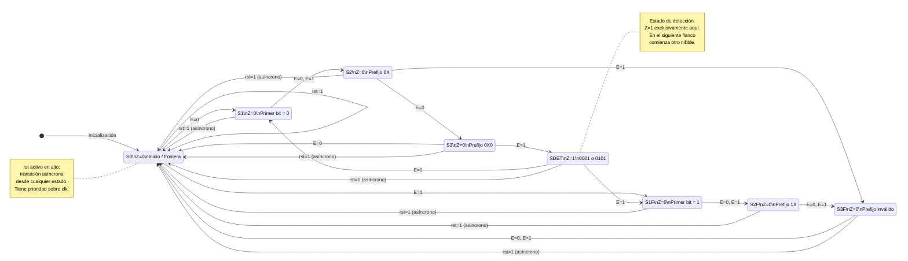

# Diseño de una Máquina de Estados Finitos (FSM) tipo Moore
## Detector de números binarios 0001 (1) y 0101 (5)

### 1. Planteamiento del problema

Se requiere diseñar una Máquina de Estados Finitos (FSM) de tipo Moore que permita identificar exclusivamente los números decimales 1 y 5, representados mediante palabras binarias de cuatro bits (nibbles), dentro de una cadena de datos de entrada serial.

La máquina tendrá una entrada de datos `E`, por la cual recibirá secuencialmente los bits desde el más significativo (MSB) hasta el menos significativo (LSB). La evaluación de cada nibble se realizará en cuatro ciclos de reloj, sin permitir el traslape entre palabras consecutivas.

Las especificaciones del diseño son:

- **Entrada serial (E):** recibe un bit por cada flanco activo del reloj.
- **Orden de entrada:** MSB → LSB.
- **Palabras objetivo:** `0001` y `0101`.
- **Salida (Z):** vale `1` cuando se detecta alguno de los dos números y `0` en cualquier otro caso.
- **Tipo de máquina:** Moore, donde la salida depende exclusivamente del estado actual.
- **Reloj (clk):** sincroniza las transiciones normales de estado.
- **Reset (rst):** asíncrono y activo en alto. Fuerza inmediatamente el estado inicial S0, independientemente del reloj.
- **Detección sin traslape:** cada grupo de cuatro bits se evalúa de manera independiente.

### 2. Fundamento teórico

Una Máquina de Estados Finitos (FSM) es un modelo secuencial que representa un sistema mediante un conjunto finito de estados y transiciones condicionadas por sus entradas.

En una máquina de tipo Moore, la salida depende exclusivamente del estado actual:

$$
Z=f(Q)
$$

Donde:

- \(Z\): salida de la máquina.
- \(Q\): estado actual.

Las transiciones se determinan mediante la función:

$$
Q_{siguiente}=f(Q,E)
$$

Donde \(E\) representa la entrada serial.

#### 2.1. Identificación de los patrones

Los números que deben reconocerse son:

| Decimal | Binario | Bits recibidos |
|---|---|---|
| 1 | `0001` | 0 → 0 → 0 → 1 |
| 5 | `0101` | 0 → 1 → 0 → 1 |

Se observa que ambos patrones comparten las siguientes características:

- El primer bit siempre es `0`.
- El segundo bit puede ser `0` o `1`.
- El tercer bit siempre es `0`.
- El cuarto bit siempre es `1`.

Por lo tanto, la condición lógica de detección es:

$$
\boxed{Z_{\text{detección}}=\overline{b_3}\cdot\overline{b_1}\cdot b_0}
$$

El bit \(b_2\) no afecta la detección, pero debe recibirse para completar el nibble.

Esta expresión describe la condición de reconocimiento de una palabra completa. En la implementación Moore, la salida se activa mediante el estado SDET.

#### 2.2. Funcionamiento sin traslape

La máquina procesa exclusivamente bloques consecutivos de cuatro bits.

Por ejemplo, para la cadena:

`0001 0101 0010 0001`

La evaluación se realiza de la siguiente manera:

| Nibble | Bits recibidos | Resultado | Z |
|---|---|---|---|
| 1 | `0001` | Detectado | 1 |
| 2 | `0101` | Detectado | 1 |
| 3 | `0010` | No detectado | 0 |
| 4 | `0001` | Detectado | 1 |

La máquina no reutiliza bits de una palabra anterior para evaluar la siguiente.

Después de recibir el cuarto bit, alcanza un estado de finalización. En el siguiente flanco activo de reloj comienza a procesar el primer bit del nuevo nibble.

### 3. Optimización y reducción de estados

El diseño inicial contemplaba 11 estados. Sin embargo, mediante la equivalencia de estados se identificaron tres pares de estados con comportamientos idénticos:

| Estados originales | Estados equivalentes | Justificación |
|---|---|---|
| S00 y S01 | S2 | Sus transiciones conducen a estados equivalentes. |
| S000 y S010 | S3 | Ambos tienen las mismas transiciones y salida. |
| S0 y SERR | S0 | Ambos presentan las mismas transiciones y salida. |

La equivalencia se determina considerando tanto la salida como las transiciones ante todas las entradas posibles.

Después de fusionar los estados equivalentes, se obtiene una FSM de ocho estados.

Esta reducción permite utilizar solamente tres flip-flops para representar los estados:

$$
N_{FF}=\lceil\log_2(8)\rceil=3
$$

### 4. Definición de estados

Se utilizan los siguientes ocho estados:

| Estado | Descripción | Información recibida | Z |
|---|---|---|---|
| S0 | Estado inicial o frontera entre nibbles | Ningún bit del nuevo nibble | 0 |
| S1 | Primer bit válido | `0` | 0 |
| S1F | Primer bit inválido | `1` | 0 |
| S2 | Dos bits procesados, prefijo válido | `0X` | 0 |
| S2F | Dos bits procesados, prefijo inválido | `1X` | 0 |
| S3 | Tres bits procesados, prefijo válido | `0X0` | 0 |
| S3F | Tres bits procesados, prefijo inválido | Cualquier otro prefijo | 0 |
| SDET | Detección de palabra válida | `0001` o `0101` | **1** |

Donde `X` representa un bit indiferente, es decir, puede tomar el valor `0` o `1`.

La letra `F` identifica estados asociados con prefijos que ya no pueden producir una coincidencia válida.

**Importante:** S0 representa tanto el inicio después del reset como la frontera entre dos nibbles. El cuarto bit de cada palabra se consume antes de regresar a S0.

### 5. Tabla de transiciones de estados

La siguiente tabla establece el comportamiento de la FSM ante cada posible valor de entrada.

| Estado actual | E = 0 | E = 1 | Salida Z |
|---|---|---|---|
| S0 | S1 | S1F | 0 |
| S1 | S2 | S2 | 0 |
| S1F | S2F | S2F | 0 |
| S2 | S3 | S3F | 0 |
| S2F | S3F | S3F | 0 |
| S3 | S0 | SDET | 0 |
| S3F | S0 | S0 | 0 |
| SDET | S1 | S1F | 1 |

#### 5.1. Explicación de las transiciones

**Desde S0:**

- Si E = 0, pasa a S1.
- Si E = 1, pasa a S1F.

Se recibe el primer bit del nibble.

**Desde S1:**

- Independientemente de E, pasa a S2.

Se reciben los dos primeros bits `0X`. Ambos valores son compatibles con los números buscados.

**Desde S1F:**

- Independientemente de E, pasa a S2F.

El primer bit fue `1`, por lo que el nibble ya no puede coincidir con los patrones objetivo.

**Desde S2:**

- Si E = 0, pasa a S3.
- Si E = 1, pasa a S3F.

El tercer bit debe ser necesariamente `0`.

**Desde S2F:**

- Independientemente de E, pasa a S3F.

El prefijo ya es inválido.

**Desde S3:**

- Si E = 0, pasa a S0. Se completa un nibble inválido.
- Si E = 1, pasa a SDET. Se detecta `0001` o `0101`.

**Desde S3F:**

- Independientemente de E, pasa a S0.

Se completa un nibble inválido.

**Desde SDET:**

- Si E = 0, pasa a S1.
- Si E = 1, pasa a S1F.

Se activa la salida Z = 1 durante el periodo correspondiente al estado SDET. En el siguiente flanco de reloj comienza la evaluación del siguiente nibble.

### 6. Tabla de salidas (Moore)

La salida se determina exclusivamente mediante el estado actual:

| Estado | Z |
|---|---|
| S0 | 0 |
| S1 | 0 |
| S1F | 0 |
| S2 | 0 |
| S2F | 0 |
| S3 | 0 |
| S3F | 0 |
| SDET | 1 |

Por tanto:

$$
\boxed{Z=1\iff Q=SDET}
$$

La salida permanece activa durante un periodo de reloj completo, hasta que la FSM abandona SDET.

### 7. Diagrama de estados Mermaid

El siguiente diagrama representa las transiciones de la FSM simplificada. Las flechas continuas representan transiciones condicionadas por E, mientras que las transiciones de reset se identifican explícitamente.

**Nota sobre el diagrama:** Mermaid permite representar las transiciones mediante flechas, pero no modela eléctricamente el comportamiento asíncrono. Las flechas de reset representan una condición de prioridad independiente del reloj, no transiciones síncronas adicionales.

### 8. Verificación mediante una secuencia de entrada

Se considera la siguiente cadena serial:

`0001 0101 0010 0001`

Se supone que rst ya fue liberado y que el primer bit se recibe en el primer flanco activo de clk.

| Ciclo | E | Estado actual | Estado siguiente | Z |
|---:|:---:|---|---|:---:|
| 1 | 0 | S0 | S1 | 0 |
| 2 | 0 | S1 | S2 | 0 |
| 3 | 0 | S2 | S3 | 0 |
| 4 | 1 | S3 | SDET | **1** |
| 5 | 0 | SDET | S1 | 1 |
| 6 | 1 | S1 | S2 | 0 |
| 7 | 0 | S2 | S3 | 0 |
| 8 | 1 | S3 | SDET | **1** |
| 9 | 0 | SDET | S1 | 1 |
| 10 | 0 | S1 | S2 | 0 |
| 11 | 1 | S2 | S3F | 0 |
| 12 | 0 | S3F | S0 | 0 |
| 13 | 0 | S0 | S1 | 0 |
| 14 | 0 | S1 | S2 | 0 |
| 15 | 0 | S2 | S3 | 0 |
| 16 | 1 | S3 | SDET | **1** |

**Observación sobre la tabla:** Z se calcula a partir del estado actual antes del flanco que realiza la transición. Por eso, después de detectar una palabra, la salida continúa en 1 durante el siguiente intervalo correspondiente a SDET y vuelve a 0 cuando la máquina entra en S1 o S1F.

La secuencia confirma que se detectan correctamente los tres nibbles válidos y se rechaza el nibble `0010`.

### 9. Consideraciones de implementación física

Para llevar la FSM a un circuito secuencial, se deben considerar los siguientes aspectos:

**Reloj (clk):**
- Las transiciones normales ocurren en el flanco activo de reloj.
- Se utiliza un único reloj para todos los flip-flops de estado.

**Reset (rst):**
- Se define como activo en alto.
- Cuando rst = 1, la máquina regresa inmediatamente a S0.
- No necesita esperar un flanco de reloj.
- Para una implementación física, se recomienda sincronizar la desactivación del reset con el reloj, evitando problemas de recuperación y remoción de los flip-flops.

**Salida (Z):**
- Se obtiene mediante la decodificación del estado SDET.
- No depende directamente de E.
- No requiere una detección combinacional independiente de los cuatro bits de entrada.

**Codificación de estados:**
- Se requieren ocho estados.
- Se necesitan tres flip-flops como mínimo para su codificación binaria.
- La asignación específica de los códigos binarios puede realizarse posteriormente, considerando la simplificación de las ecuaciones de próximo estado.

### 10. Conclusiones

La FSM propuesta cumple con los requisitos funcionales del problema:

1. Identifica exclusivamente las palabras binarias `0001` y `0101`.
2. Recibe los bits en orden MSB → LSB.
3. Evalúa cada nibble en exactamente cuatro ciclos de reloj.
4. No permite el traslape entre palabras consecutivas.
5. Implementa una salida de tipo Moore que se activa únicamente en SDET.
6. Incorpora un reset asíncrono que regresa la máquina al estado inicial.
7. Reduce el diseño original de once a ocho estados mediante equivalencia de estados.

La máquina simplificada conserva el comportamiento funcional del diseño original y requiere únicamente tres flip-flops para almacenar su estado.

**Resultado final:** FSM de Moore de ocho estados para la detección serial, sin traslape, de los nibbles `0001` y `0101`.
