# Registro de Progreso (state/PROGRESS.md)

---

## 1. Estado de Subtareas

```mermaid
flowchart TD
    T1["✅ Entorno .venv (Python 3.14.6)"] --> T2["✅ Centralización pyproject.toml"]
    T2 --> T3["✅ Kernel Jupyter Quarto"]
    T3 --> T4["✅ docs/ARCHITECTURE.md & GLOSSARY.md"]
    T4 --> T5["✅ Centralización en state/"]
    T5 --> T6["✅ Entorno sandbox/ & Blast Radius"]
    T6 --> T7["✅ Suite tests/validate_metadata.py (Pytest 6/6)"]
    T7 --> T8["✅ Git init & docs/BUENAS_PRACTICAS.md"]
    T8 --> T9["✅ Álgebra de Boole (LaTeX, Typst & LFS)"]
    T9 --> T10["✅ Electromagnetismo: Práctica 1 (Cálculos >12 dig. & Cuestionario)"]
    T10 --> T11["✅ Cuestionario Oficial Resuelto & Entregables PDF/Word (Pandoc & Typst)"]
    T11 --> T12["✅ Optimización Cuestionario: Notación de Ingeniería, Poda Verbosa y OMML Word"]
    T12 --> T13["✅ Alternativas a Pandoc: markdocx (OMML MML2OMML.XSL) & Quarto"]
    T13["✅ Investigación Bypass PDF -> Word & Análisis Comparativo OMML"] --> T14
    T14["✅ Tarea 1 Era III (X.25, ISDN, GSM/CDMA): Síntesis Verificada y Auditoría APA 7"] --> T15
    T15["✅ Línea del Tiempo Era III con Glosario y Fechas Contrastadas"] --> T16
    T16["✅ Línea del Tiempo Era III en CSV TimelineJS (30 hitos, eras, imágenes) y Nuevas Fuentes"] --> T17
    T17["✅ Excepción AGENTS.md §13 y Libro .xlsx Editable en Excel"] --> T18
    T18["✅ Los 30 Hitos de la Línea del Tiempo con Imagen en Alta Definición"] --> T19
    T19["✅ Informe en Word (.docx) del Entregable y Excepción §13 Ampliada a .docx"] --> T20
    T20["✅ Lámina de Máquinas de Estado Finitos (Typst, hoja carta) y Guía `estilos_typst.md`"]
```

---

## 2. Bitácora Cronológica

- **2026-09-01 21:37:39:** Creación de `.venv` con Python 3.14.6 y verificación de herramientas (`typst`, `quarto`, `pdflatex`).
- **2026-09-01 21:40:43:** Instalación y prueba de importación de librerías (`numpy`, `scipy`, `sympy`, `schemdraw`, `pylatex`, `reportlab`, `plotly`).
- **2026-09-01 21:41:28:** Creación de [`pyproject.toml`](file:///G:/REPOSITORIOS%20GITHUB/RECURSOS/pyproject.toml) como única fuente de dependencias.
- **2026-09-01 21:55:41:** Sincronización de materias en [`docs/ARCHITECTURE.md`](file:///G:/REPOSITORIOS%20GITHUB/RECURSOS/docs/ARCHITECTURE.md) (`Circuitos`, `Electromagnetismo`, `Telecomunicaciones`, `VHDL`).
- **2026-09-01 22:05:48:** Centralización y optimización de los 4 archivos de memoria y estado en [`state/`](file:///G:/REPOSITORIOS%20GITHUB/RECURSOS/state).
- **2026-09-01 22:08:51:** Implementación de [`sandbox/`](file:///G:/REPOSITORIOS%20GITHUB/RECURSOS/sandbox) como entorno de experimentación y prototipado didáctico con `.gitignore`, [`README.md`](file:///G:/REPOSITORIOS%20GITHUB/RECURSOS/sandbox/README.md) y [`sandbox_guide.md`](file:///G:/REPOSITORIOS%20GITHUB/RECURSOS/sandbox/sandbox_guide.md).
- **2026-09-01 22:18:00:** Integración de [`GLOSSARY.md`](file:///G:/REPOSITORIOS%20GITHUB/RECURSOS/GLOSSARY.md) (`03_glossary`) y estandarización del modelo **Slug Secuencial Numérico (`XX_snake_case`)**.
- **2026-09-01 22:21:00:** Verificación de implementaciones, eliminación del archivo transitorio `plan_recursos_sistema.md` y reajuste canónico de la secuencia de IDs (`00_` a `09_`), estableciendo `sandbox/` como el espacio exclusivo para planes temporales.
- **2026-09-01 22:28:00:** Implementación del validador determinista de metadatos [`tests/validate_metadata.py`](file:///G:/REPOSITORIOS%20GITHUB/RECURSOS/tests/validate_metadata.py) y suite de pruebas unitarias [`tests/test_validate_metadata.py`](file:///G:/REPOSITORIOS%20GITHUB/RECURSOS/tests/test_validate_metadata.py) con exclusión estricta de `formato_minimo/`, tipado estricto `mypy` y cobertura de esquemas `Draft 2020-12`.
- **2026-09-01 22:34:00:** Auditoría y blindaje exhaustivo de [`.gitignore`](file:///G:/REPOSITORIOS%20GITHUB/RECURSOS/.gitignore) para cubrir todas las cachés de Python (`__pycache__`, `*.pyd`, `.hypothesis`, `.tox`), Jupyter (`.ipynb_checkpoints`), Quarto (`.quarto`, `*_files`, `*_cache`), Typst y compilación auxiliar LaTeX (`*.aux`, `*.fls`, `*.synctex.gz`, `*.toc`, etc.).
- **2026-09-01 22:45:00:** Inicialización del repositorio Git (`git init`), creación de la guía de buenas prácticas [`docs/BUENAS_PRACTICAS.md`](file:///G:/REPOSITORIOS%20GITHUB/RECURSOS/docs/BUENAS_PRACTICAS.md) (`04_buenas_practicas`) y sincronización secuencial de IDs (`00_` a `10_`).
- **2026-09-01 23:18:00:** Modernización y adaptación contextual de todos los esquemas JSON en [`schemas/`](file:///G:/REPOSITORIOS%20GITHUB/RECURSOS/schemas) (`frontmatter`, `manifest`, `memory_entry`, `rules`), añadiendo categoría `syllabus`, metadatos a los 4 temarios de `src/` (`11_` a `14_`) y validación integral con `jsonschema.Draft202012Validator`.
- **2026-09-01 23:30:00:** Incorporación en [`AGENTS.md`](file:///G:/REPOSITORIOS%20GITHUB/RECURSOS/AGENTS.md) (§7.2 y §9.8) de la regla obligatoria de actualización de estado en `state/` previa a cualquier push remoto, y consolidación atómica del commit inicial v1.0.0 en el repositorio GitHub.
- **2026-09-01 23:45:00:** Creación del compendio [`src/VHDL/algebra_boole.md`](file:///G:/REPOSITORIOS%20GITHUB/RECURSOS/src/VHDL/algebra_boole.md) con formulación matemática completa en $\LaTeX$ incrustado y validación canónica de metadatos (`15_algebra_boole`).
- **2026-09-01 23:55:00:** Configuración de [`.gitignore`](file:///G:/REPOSITORIOS%20GITHUB/RECURSOS/.gitignore) y [`.gitattributes`](file:///G:/REPOSITORIOS%20GITHUB/RECURSOS/.gitattributes) para seguimiento de imágenes generadas e integración de Git LFS para artefactos binarios (`.png`, `.pdf`) en `output/`.
- **2026-09-02 00:05:00:** Prototipado y estilización de lámina vectorial en Typst con paleta de colores didácticos (variables en azul, números en rojo, negaciones en púrpura, operadores en verde esmeralda) y ordenamiento horizontal izquierda a derecha.
- **2026-09-02 00:10:00:** Incorporación en [`src/VHDL/algebra_boole.md`](file:///G:/REPOSITORIOS%20GITHUB/RECURSOS/src/VHDL/algebra_boole.md) del Teorema de Expansión de Shannon (LUT/MUX), formalización del Principio de Dualidad e identidades complementarias XOR/XNOR para síntesis RTL.
- **2026-09-02 00:15:00:** Promoción del código Typst desde el sandbox al módulo canónico [`src/VHDL/algebra_boole.typ`](file:///G:/REPOSITORIOS%20GITHUB/RECURSOS/src/VHDL/algebra_boole.typ), emisión de artefactos en `output/` y sincronización con el repositorio remoto.
- **2026-09-03 22:15:00:** Elevación de precisión en [`src/Electromagnetismo/PRACTICA_1_RESUMEN.md`](file:///G:/REPOSITORIOS%20GITHUB/RECURSOS/src/Electromagnetismo/PRACTICA_1_RESUMEN.md) a más de 12 cifras significativas exactas (constantes $c$, $\mu_0$, $\varepsilon_0$, $\eta_0$, longitud de onda $\lambda$, monopolo $\lambda/4$, pérdidas FSPL continuas y tabla experimental). Extracción y creación del banco exhaustivo [`src/Electromagnetismo/PRACTICA_1_CUESTIONARIO.md`](file:///G:/REPOSITORIOS%20GITHUB/RECURSOS/src/Electromagnetismo/PRACTICA_1_CUESTIONARIO.md) (`18_practica_1_cuestionario`) con 30 preguntas avanzadas (Fresnel, dos rayos, Maxwell, condiciones de frontera, efecto pelicular, carta de Smith, ruido térmico Johnson-Nyquist y Shannon), incorporación de metadatos canónicos en [`PRACTICA_1_ORIGINAL.md`](file:///G:/REPOSITORIOS%20GITHUB/RECURSOS/src/Electromagnetismo/PRACTICA_1_ORIGINAL.md) y superación del 100% de la suite de pruebas Pytest (6/6).
- **2026-09-03 22:52:00:** Resolución analítica de las 10 preguntas oficiales en [`src/Electromagnetismo/PRACTICA_1_CUESTIONARIO_OFICIAL.md`](file:///G:/REPOSITORIOS%20GITHUB/RECURSOS/src/Electromagnetismo/PRACTICA_1_CUESTIONARIO_OFICIAL.md) (`19_practica_1_cuestionario_oficial`) con fundamentación en las Ecuaciones de Maxwell, deducción de la ecuación de Helmholtz, propagación atmosférica, modulación ASK/OOK y receptores superregenerativos. Generación exitosa de los formatos de distribución en [`output/PRACTICA_1_CUESTIONARIO_OFICIAL.docx`](file:///G:/REPOSITORIOS%20GITHUB/RECURSOS/output/PRACTICA_1_CUESTIONARIO_OFICIAL.docx) (Word nativo OMML vía Pandoc) y [`output/PRACTICA_1_CUESTIONARIO_OFICIAL.pdf`](file:///G:/REPOSITORIOS%20GITHUB/RECURSOS/output/PRACTICA_1_CUESTIONARIO_OFICIAL.pdf) (vía Pandoc y Typst engine). Validación del 100% de la suite Pytest.
- **2026-09-03 23:06:00:** Optimización y síntesis de respuestas en [`src/Electromagnetismo/PRACTICA_1_CUESTIONARIO_OFICIAL.md`](file:///G:/REPOSITORIOS%20GITHUB/RECURSOS/src/Electromagnetismo/PRACTICA_1_CUESTIONARIO_OFICIAL.md): reducción de redundancias y extensión verbosa para cuestionario preliminar, redondeo a notación de ingeniería (2-3 cifras significativas con prefijos SI), supresión total de diagramas Mermaid para compatibilidad tipográfica, y reestructuración de fórmulas matemáticas a bloques Display aislados `$$...$$` sin macros de acento combinatorio. Recompilación determinista con Pandoc generando [`output/PRACTICA_1_CUESTIONARIO_OFICIAL.docx`](file:///G:/REPOSITORIOS%20GITHUB/RECURSOS/output/PRACTICA_1_CUESTIONARIO_OFICIAL.docx) con ecuaciones Display OMML y fracciones apiladas verticales (`<m:type m:val="bar"/>`), [`output/PRACTICA_1_CUESTIONARIO_OFICIAL.pdf`](file:///G:/REPOSITORIOS%20GITHUB/RECURSOS/output/PRACTICA_1_CUESTIONARIO_OFICIAL.pdf) (vía Typst) y renderizado universal [`output/PRACTICA_1_CUESTIONARIO_OFICIAL.html`](file:///G:/REPOSITORIOS%20GITHUB/RECURSOS/output/PRACTICA_1_CUESTIONARIO_OFICIAL.html) (con MathJax). Verificación satisfactoria de pruebas unitarias Pytest (6/6).
- **2026-09-03 23:16:00:** Investigación, instalación y validación experimental de alternativas autónomas a Pandoc para Markdown a Word (`.docx`) con renderizado de fórmulas $\LaTeX$. Instalación exitosa de [`markdocx`](https://pypi.org/project/markdocx/) v10.0.2 e integración en `pyproject.toml`. Conversión determinista en 0.18s de [`src/Electromagnetismo/PRACTICA_1_CUESTIONARIO_OFICIAL.md`](file:///G:/REPOSITORIOS%20GITHUB/RECURSOS/src/Electromagnetismo/PRACTICA_1_CUESTIONARIO_OFICIAL.md) hacia [`output/PRACTICA_1_CUESTIONARIO_OFICIAL_markdocx.docx`](file:///G:/REPOSITORIOS%20GITHUB/RECURSOS/output/PRACTICA_1_CUESTIONARIO_OFICIAL_markdocx.docx), validando el enlace automático con la hoja de estilos oficial de Microsoft `MML2OMML.XSL` (`12` ecuaciones Display `<m:oMathPara>` y `17` fracciones apiladas verticales `<m:type m:val="bar"/>`). Generación comparativa con Quarto CLI (`quarto render --to docx`) y documentación completa de instalación en Windows 11 (incluyendo `winget install writage.writage` y `@mohtasham/md-to-docx`). Superación del 100% de la suite Pytest (6/6).
- **2026-09-04 22:20:00:** Investigación, implementación y ejecución exhaustiva del banco de pruebas de renderizado LaTeX a Word DOCX con soporte OMML nativo en [`sandbox/omml_latex_docx/`](file:///G:/REPOSITORIOS%20GITHUB/RECURSOS/sandbox/omml_latex_docx). Se desarrollaron y validaron 6 métodos técnicos: (1) Pipeline Python autónomo (`latex2mathml` + `MML2OMML.XSL` + `python-docx`) con 100% de éxito en ecuaciones Display/Inline nativas y cero dependencias de Office; (2) Quarto CLI (`quarto render --to docx`) con soporte OMML completo; (3) Ecosistema Node.js (`docx` npm + `temml` / MathML) con objetos matemáticos nativos; (4) Automatización COM Word / PowerShell con `OMaths.Add` y `BuildUp()`; (5) Typst $\rightarrow$ Pandoc $\rightarrow$ DOCX (`pandoc -f typst -t docx`); y (6) Demostración de degradación del importador directo HTML de Word (`Documents.Open`). Documentación completa en [`sandbox/omml_latex_docx/README.md`](file:///G:/REPOSITORIOS%20GITHUB/RECURSOS/sandbox/omml_latex_docx/README.md) y runner maestro [`sandbox/omml_latex_docx/run_all_experiments.py`](file:///G:/REPOSITORIOS%20GITHUB/RECURSOS/sandbox/omml_latex_docx/run_all_experiments.py).
- **2026-09-16 19:20:00:** Creación de [`src/Telecomunicaciones/TAREA_1_ERA_TECNOLOGICA.md`](file:///G:/REPOSITORIOS%20GITHUB/RECURSOS/src/Telecomunicaciones/TAREA_1_ERA_TECNOLOGICA.md) (`20_tarea_1_era_tecnologica`) con la síntesis verificada de la Era III (X.25, ISDN/RDSI y telefonía celular 1G/2G GSM e IS-95) depurada desde [`src/Telecomunicaciones/ERA_3_NOTEBOOK.md`](file:///G:/REPOSITORIOS%20GITHUB/RECURSOS/src/Telecomunicaciones/ERA_3_NOTEBOOK.md): se conservó únicamente la información atribuida a las tres fuentes bibliográficas, se descartaron los bloques declarados como no disponibles (inventariados como brechas en el Anexo A), se organizó el contenido en las cinco fases de indagación con matriz comparativa y diagramas Mermaid, y se auditó el formato APA 7 de las referencias (poda de edición redundante, supresión de "Editorial", separador punto y coma para edición y traductor, y orden alfabético). Validación de metadatos frontmatter conforme al esquema `Draft 2020-12`; la suite Pytest conserva 2 fallos preexistentes por falta de frontmatter en `ERA_3_NOTEBOOK.md` y `ERAS_TECNOLOGICAS.md` (ajenos a esta tarea).
- **2026-09-16 20:10:00:** Creación de [`src/Telecomunicaciones/LINEA_DEL_TIEMPO.md`](file:///G:/REPOSITORIOS%20GITHUB/RECURSOS/src/Telecomunicaciones/LINEA_DEL_TIEMPO.md) (`21_linea_del_tiempo`) con la línea del tiempo de la Era III derivada de [`src/Telecomunicaciones/TAREA_1_ERA_TECNOLOGICA.md`](file:///G:/REPOSITORIOS%20GITHUB/RECURSOS/src/Telecomunicaciones/TAREA_1_ERA_TECNOLOGICA.md): 25 hitos fechados en tres bloques (antecedentes y conmutación de paquetes, 1G analógica y digitalización RDSI/GSM/IS-95), glosario de 37 siglas y tabla de correcciones. El contraste externo de fechas corrigió cinco datos de la libreta: creación del grupo GSM en la CEPT (1982) frente a su transferencia a la ETSI (1989), despliegue comercial de GSM en 1991, estandarización de la RDSI en 1988, apertura del servicio NMT en 1981 y separación entre aprobación de IS-95 (1993) y su despliegue comercial (1995); además se corrigió la expansión del acrónimo AMPS. Validación de metadatos frontmatter conforme al esquema `Draft 2020-12`.
- **2026-09-19 15:45:00:** Investigación externa y creación de [`src/Telecomunicaciones/nuevas_fuentes.md`](file:///G:/REPOSITORIOS%20GITHUB/RECURSOS/src/Telecomunicaciones/nuevas_fuentes.md) (`22_nuevas_fuentes`): los dos hitos sin fecha exacta de la tabla 2.1 de la línea del tiempo se resolvieron en siete hitos fechados, con la primera publicación o entrada en servicio documentada de cada uno. La «Década de 1960» se sustituye por los informes RAND de Baran (1960-1964), la propuesta de tesis de Kleinrock (1961) y el artículo y la propuesta del NPL de Davies (1965-1966, con la red local en servicio en 1969 y el Mark I operativo en enero de 1970); los «Finales de los años 70» se sustituyen por la entrada en servicio de Telenet (16 de agosto de 1975), el anuncio de DATAPAC (marzo de 1976), la apertura de TRANSPAC (diciembre de 1978) y la creación de la IPSS (1978). Se precisó además que el borrador de la Recomendación X.25 está fechado en marzo de 1976 y que su aprobación unánime se produjo en la asamblea plenaria del CCITT de septiembre del mismo año. El documento registra el método de contraste, las tablas de hitos y fuentes con fecha de consulta, los créditos y licencias de las ocho imágenes de Wikimedia Commons y las referencias en APA 7 (terciarias de contraste y primarias/secundarias citadas por ellas).
- **2026-09-19 15:58:00:** Creación de la utilidad de un solo uso [`sandbox/generar_linea_del_tiempo_csv.py`](file:///G:/REPOSITORIOS%20GITHUB/RECURSOS/sandbox/generar_linea_del_tiempo_csv.py) y generación de [`src/Telecomunicaciones/linea_del_tiempo_tema_1.csv`](file:///G:/REPOSITORIOS%20GITHUB/RECURSOS/src/Telecomunicaciones/linea_del_tiempo_tema_1.csv) en el formato de hoja de cálculo de TimelineJS (19 columnas literales): una portada (`title`) con fondo propio, tres bandas temporales (`era`, 1947-1980, 1981-1986 y 1987-2000) y 30 hitos, de los cuales ocho incorporan imagen de Wikimedia Commons con crédito, pie y texto alternativo. La utilidad escribe en UTF-8 sin BOM con finales de línea `LF` y comillas internas duplicadas, y su modo `--check` valida encabezado, ancho de fila, coherencia de fechas y tipos, obligatoriedad de crédito y texto alternativo cuando hay media, ausencia de flechas de texto plano (AGENTS.md §5.7) y la prohibición de `End Year` en los eventos para no solaparse con las bandas `era`.
- **2026-09-19 16:05:00:** Sincronización documental de [`src/Telecomunicaciones/LINEA_DEL_TIEMPO.md`](file:///G:/REPOSITORIOS%20GITHUB/RECURSOS/src/Telecomunicaciones/LINEA_DEL_TIEMPO.md): las tablas de las secciones 2 y 3 se conservan intactas y el refinamiento se documenta en la nueva sección 5 «Formato de distribución y artefactos derivados», con un diagrama Mermaid del flujo de artefactos, la tabla de entregables y la nota de trazabilidad de los hitos desdoblados. El frontmatter sube a `version: 1.1.0`, con `updated_at`, las etiquetas `timelinejs` y `csv` y `related_specs: [22_nuevas_fuentes]`.
- **2026-09-19 16:10:00:** Validación final de la entrega: `pytest tests/ -q` conserva 5 pruebas superadas y el único fallo preexistente por falta de frontmatter en `ERA_3_NOTEBOOK.md` y `ERAS_TECNOLOGICAS.md` (los artefactos nuevos no añaden errores de metadatos); `ruff check` sin hallazgos, `ruff format` aplicado y `mypy --strict` sin incidencias sobre la utilidad; regeneración determinista del CSV con 1 portada, 3 eras y 30 eventos.
- **2026-09-19 17:10:00:** Incorporación en [`AGENTS.md`](file:///G:/REPOSITORIOS%20GITHUB/RECURSOS/AGENTS.md) de la nueva sección 13 «Excepción autorizada para artefactos editables en Excel (`.xlsx`)», que autoriza de forma temporal las copias derivadas en libro de Excel de los entregables tabulares: se declara la excepción a la codificación UTF-8 sin BOM y a los finales de línea `LF` (contenedor binario ZIP/OPC), se mantienen la nomenclatura `snake_case`, el alojamiento de las utilidades de conversión en `sandbox/` y el presupuesto de modificación de un artefacto derivado por entregable, y se fijan seis condiciones (el CSV sigue siendo la fuente única de verdad, trazabilidad en `PROGRESS.md`, ámbito restringido a datos tabulares, dependencias declaradas en `pyproject.toml`, reversibilidad y conservación literal de la estructura). El contrato sube a `version: 1.1.0`. En [`pyproject.toml`](file:///G:/REPOSITORIOS%20GITHUB/RECURSOS/pyproject.toml) se declara `openpyxl>=3.1.0` como dependencia de la conversión y se instala la versión 3.1.5 en `.venv`.
- **2026-09-19 17:25:00:** Creación de la utilidad de un solo uso [`sandbox/generar_xlsx_linea_del_tiempo.py`](file:///G:/REPOSITORIOS%20GITHUB/RECURSOS/sandbox/generar_xlsx_linea_del_tiempo.py) y generación de [`src/Telecomunicaciones/linea_del_tiempo_tema_1.xlsx`](file:///G:/REPOSITORIOS%20GITHUB/RECURSOS/src/Telecomunicaciones/linea_del_tiempo_tema_1.xlsx): una única hoja `TimelineJS` con la cabecera literal de 19 columnas, 34 filas de datos, columnas de fecha como números, ajuste de texto en titular, texto, pie y texto alternativo, anchos de columna, panel congelado y filtro automático, y enlaces en las ocho celdas de media. El modo `--check` reabre el libro y comprueba que reproduce la cabecera literal, que no contiene fórmulas y que cada celda coincide con el CSV canónico.
- **2026-09-19 17:30:00:** Cotejo cruzado del libro con un lector independiente (`pandas.read_excel`): 34 filas por 19 columnas, cabecera idéntica y cero celdas divergentes respecto al CSV; `ruff check` sin hallazgos, `ruff format` aplicado y `mypy --strict` sin incidencias sobre la utilidad. Se documenta el artefacto derivado en la sección 5 de [`LINEA_DEL_TIEMPO.md`](file:///G:/REPOSITORIOS%20GITHUB/RECURSOS/src/Telecomunicaciones/LINEA_DEL_TIEMPO.md), con la advertencia de que el `.xlsx` no sustituye al CSV canónico.
- **2026-09-19 18:15:00:** Investigación de imágenes en Wikimedia Commons para **los 30 hitos** de la línea del tiempo (antes solo 8 disponían de media): se consultaron la API de búsqueda, el generador por categorías y el endpoint `imageinfo` (`iiprop=url|size` y `iiextmetadatafilter=LicenseShortName|Artist`) con un agente de usuario identificativo. Se aplicó el criterio de alta definición (lado mayor superior a 1000 px, preferencia por encima de 2000 px) y, cuando no existe fotografía histórica en alta resolución, se seleccionó una imagen reciente de la misma tecnología (antenas, terminales y equipamiento), señalándolo en el pie de la diapositiva. Se sustituyeron seis imágenes de baja resolución (`Paul_Baran.jpg` de 175x237 px, el retrato recortado de Kleinrock de 348x355 px, la placa de Davies de 640x531 px, `Motorola_Classic_II_Brick_Phone.jpg` de 584x848 px, `DynaTAC8000X.jpg` de 399x977 px y una antena GSM de 855x1600 px) por alternativas de entre 1080 y 5773 px de lado mayor, y se documentó el catálogo completo (autoría, licencia, resolución y enlace directo) en [`nuevas_fuentes.md`](file:///G:/REPOSITORIOS%20GITHUB/RECURSOS/src/Telecomunicaciones/nuevas_fuentes.md), que pasa a `version: 1.1.0`.
- **2026-10-11 18:50:43:** Creación del formulario [`src/Circuitos/parametros.typ`](file:///G:/REPOSITORIOS%20GITHUB/RECURSOS/src/Circuitos/parametros.typ) con la construcción de las matrices de parámetros de las 4 familias de cuadripolos ($Z$, $Y$, $H$ y $T$/$ABCD$) a partir de [`src/Circuitos/parametros.md`](file:///G:/REPOSITORIOS%20GITHUB/RECURSOS/src/Circuitos/parametros.md): ecuaciones matriciales, coeficientes con barra de evaluación y condición de ensayo (circuito abierto $I = 0$ / cortocircuito $V = 0$), unidades, aplicaciones (serie, paralelo, BJT, cascada), resumen comparativo, condiciones de reciprocidad/simetría ($z_{12} = z_{21}$, $h_{12} = -h_{21}$, $AD - BC = 1$, $A = D$) y variantes secundarias $G$ y $T'$. Verificación externa contra Wikipedia «Two-port network», UNR FCEIA (TCI Cap. 5) y UPV/EHU (Tema 12); todo el contenido de `parametros.md` resultó correcto. Compilación Typst 0.15.1 sin errores y verificación visual por recortes PNG; temporales de prototipado eliminados de `sandbox/`. La suite Pytest (5/6) conserva 3 fallos preexistentes por falta de frontmatter en `parametros.md`, `ERA_3_NOTEBOOK.md` y `ERAS_TECNOLOGICAS.md` (ajenos a esta tarea; los entregables `.typ` no están cubiertos por el validador).
- **2026-09-19 18:30:00:** Regeneración de [`linea_del_tiempo_tema_1.csv`](file:///G:/REPOSITORIOS%20GITHUB/RECURSOS/src/Telecomunicaciones/linea_del_tiempo_tema_1.csv) con las 30 imágenes (una por hito, sin repeticiones) y de [`linea_del_tiempo_tema_1.xlsx`](file:///G:/REPOSITORIOS%20GITHUB/RECURSOS/src/Telecomunicaciones/linea_del_tiempo_tema_1.xlsx) con los nuevos enlaces; la validación en modo `--check` detectó correctamente el libro obsoleto antes de regenerarlo. Verificaciones: cotejo cruzado con `pandas.read_excel` (34x19, cabecera idéntica y 0 celdas divergentes), `ruff check` y `ruff format` limpios, y `mypy --strict` sin incidencias en las dos utilidades. La disponibilidad de las URL se comprobó contra la API de Wikimedia; las peticiones `HEAD` individuales al CDN quedaron parcialmente limitadas por el control de tasa del servicio (HTTP 429), sin que ello afecte a la existencia, dimensiones y licencia de los archivos, confirmadas por la API. [`LINEA_DEL_TIEMPO.md`](file:///G:/REPOSITORIOS%20GITHUB/RECURSOS/src/Telecomunicaciones/LINEA_DEL_TIEMPO.md) sube a `version: 1.2.0` para reflejar que los 30 hitos están ilustrados.
- **2026-09-19 21:05:00:** Detección con el modo `--check` de la nueva utilidad de que la copia derivada [`linea_del_tiempo_tema_1.xlsx`](file:///G:/REPOSITORIOS%20GITHUB/RECURSOS/src/Telecomunicaciones/linea_del_tiempo_tema_1.xlsx) **no reproducía** el CSV canónico: la celda de la portada (`Text`) conservaba una redacción anterior (dos párrafos y un salto de línea residual) en lugar de los tres párrafos vigentes. Regeneración del libro con [`sandbox/generar_xlsx_linea_del_tiempo.py`](file:///G:/REPOSITORIOS%20GITHUB/RECURSOS/sandbox/generar_xlsx_linea_del_tiempo.py) y verificación celda a celda (35 filas por 19 columnas, sin fórmulas), restableciendo la invariante de AGENTS.md §13 por la que el CSV sigue siendo la fuente única de verdad. La lección se registra en [`state/MEMORY.md`](file:///G:/REPOSITORIOS%20GITHUB/RECURSOS/state/MEMORY.md): un artefacto derivado puede quedar obsoleto aunque su marca de modificación sea posterior a la del canónico, y solo el cotejo de contenido lo revela.
- **2026-09-19 21:10:00:** Creación de la prosa de enlace en [`sandbox/reporte_linea_del_tiempo_narrativa.py`](file:///G:/REPOSITORIOS%20GITHUB/RECURSOS/sandbox/reporte_linea_del_tiempo_narrativa.py) (introducción con los criterios de verificación, de imágenes y la estructura del informe; estudio de caso en cinco subsecciones sobre las limitaciones analógicas, X.25, RDSI, 1G y 2G, con citas en texto a Clark et al., 2020; Couch, 2008, y Martín Pereda, 2022) y de la utilidad de un solo uso [`sandbox/generar_reporte_docx.py`](file:///G:/REPOSITORIOS%20GITHUB/RECURSOS/sandbox/generar_reporte_docx.py), que extrae los datos de los artefactos canónicos con parsers deterministas (filas del CSV, tablas de Markdown localizadas por encabezado, frontmatter YAML y HTML de TimelineJS) y compone el informe con `python-docx`.
- **2026-09-19 21:15:00:** Generación de [`src/Telecomunicaciones/reporte_linea_del_tiempo_tema_1.docx`](file:///G:/REPOSITORIOS%20GITHUB/RECURSOS/src/Telecomunicaciones/reporte_linea_del_tiempo_tema_1.docx) (53,2 KiB, ~7.400 palabras): portada con el alcance del entregable y las versiones de las fuentes; siete secciones; los 30 hitos en viñeta con su prosa y la nota de ilustración (crédito y estado de verificación); glosario de 37 siglas; siete hitos refinados; la precisión de la Recomendación X.25; las siete correcciones del contraste de fechas; tres listas de fuentes en APA 7 (3 de la libreta, 15 de contraste y 18 primarias) y las 30 referencias de las imágenes con licencia y resolución. El documento se maqueta en A4 con márgenes de 2,54 cm y sangría francesa en las referencias, **sin tablas** y sin flechas de texto plano.
- **2026-09-19 21:20:00:** Validación integral en modo `--check` (11 comprobaciones): CSV canónico con 34 filas de datos por 19 columnas (1 portada, 3 bandas y 30 hitos); cotejo cruzado del libro derivado; biyección entre las 30 imágenes catalogadas y los hitos, con licencia y autoría coincidentes con el crédito del CSV; informe sin tablas y con las siete secciones; 30 viñetas de hitos y 37 de glosario; titulares, pies de imagen, enlaces, siglas, referencias y encabezado literal del caso de estudio presentes; ausencia de marcadores de texto plano. La revisión del volcado con `pandoc -f docx -t plain` confirmó la conversión del énfasis de Markdown de las tablas fuente en negritas y cursivas reales y la limpieza de comillas y puntos finales en las citas angulares.
- **2026-09-19 21:30:00:** Generalización de la excepción autorizada de [`AGENTS.md`](file:///G:/REPOSITORIOS%20GITHUB/RECURSOS/AGENTS.md) §13 a los artefactos binarios derivados (`.xlsx` y `.docx`), con el alcance del informe en `src/Telecomunicaciones/`, la exigencia de integridad (sin tablas ni contenido ajeno a las fuentes citadas) y la reversibilidad; el contrato pasa a `version: 1.2.0`. Declaración explícita de `python-docx>=1.2.0` en el bloque de ofimática de [`pyproject.toml`](file:///G:/REPOSITORIOS%20GITHUB/RECURSOS/pyproject.toml) y sincronización de la sección 5 de [`LINEA_DEL_TIEMPO.md`](file:///G:/REPOSITORIOS%20GITHUB/RECURSOS/src/Telecomunicaciones/LINEA_DEL_TIEMPO.md) (diagrama Mermaid y tabla de artefactos, `version: 1.3.0`; `nuevas_fuentes.md` conserva la 1.1.0).
- **2026-09-19 21:35:00:** Verificación final: `pytest tests/ -q` conserva 5 pruebas superadas y el único fallo preexistente por falta de frontmatter en `ERA_3_NOTEBOOK.md` y `ERAS_TECNOLOGICAS.md`; `ruff check` sin hallazgos, `ruff format` aplicado y `mypy --strict` sin incidencias sobre las dos utilidades nuevas; regeneración determinista del informe y validación en modo `--check` sin hallazgos.
- **2026-10-18 13:25:00:** Creación de la lámina didáctica [`src/VHDL/maquinas_de_estado.typ`](file:///G:/REPOSITORIOS%20GITHUB/RECURSOS/src/VHDL/maquinas_de_estado.typ) en **hoja carta** (3 páginas) y de la guía de estilos [`estilos_typst.md`](file:///G:/REPOSITORIOS%20GITHUB/RECURSOS/estilos_typst.md) (`23_estilos_typst`). La lámina reutiliza la paleta y los componentes de [`src/VHDL/algebra_boole.typ`](file:///G:/REPOSITORIOS%20GITHUB/RECURSOS/src/VHDL/algebra_boole.typ) y desarrolla siete tarjetas: (1) arquitectura con diagrama de bloques de entradas, función de transición $delta$, registro de estado, lógica de salida $lambda$, reloj y reset; (2) comparativa Moore frente a Mealy; (3) diagrama de estados del detector de la secuencia «10» con auto-transiciones y retorno; (4) tabla de transición y ecuaciones $q_1^+ = overline(q_1) dot q_0 dot overline(x)$, $q_0^+ = x$, $y = q_1 dot overline(q_0)$, contrastadas con la tabla; (5) flujo de diseño en seis pasos; (6) plantilla VHDL de dos procesos; y (7) verificación y errores frecuentes. Los diagramas son vectoriales nativos (`curve`, `polygon`, `place`) sin paquetes externos; la punta de flecha se calcula con `calc.sin`/`calc.cos` porque `rotate(origin:)` solo admite alineaciones. Verificación visual en dos pasadas (PNG 130 ppp de maqueta y recortes a 300 ppp), corrección de solapamiento entre la etiqueta de retorno y el separador de la leyenda, y `breakable: false` en las tarjetas tras detectar cortes entre páginas. Artefactos generados: [`output/maquinas_de_estado.pdf`](file:///G:/REPOSITORIOS%20GITHUB/RECURSOS/output/maquinas_de_estado.pdf) y tres SVG por página; se conserva la excepción panorámica de `algebra_boole.typ` (350 mm) documentada en la nueva guía. Registro del ID `23_estilos_typst` en la tabla canónica de `AGENTS.md` §4.1.
- **2026-10-18 13:57:00:** Refinamiento didáctico de [`src/VHDL/maquinas_de_estado.typ`](file:///G:/REPOSITORIOS%20GITHUB/RECURSOS/src/VHDL/maquinas_de_estado.typ) en tres frentes. (1) Arquitectura (§1): la caja *Lógica de Salida* se desplazó a `x = 92 mm` de modo que la flecha de estado $Q$ del registro termina sobre su borde superior, y *Salidas* pasó a `x = 148 mm`; antes la flecha moría en el vacío y el ojo la asociaba al bloque de salidas. (2) Diagrama de estados (§3): la auto-transición se redibujó como parábola simétrica respecto de la vertical del centro del estado (`w = 5,2 mm`, `dIn = 8,4 mm`, `rise = 7 mm`) con la punta en el extremo izquierdo y tangente vertical, y el lienzo bajó a 58 mm con todas las etiquetas recentradas. (3) Resaltado de sintaxis (§6): se incorporó un tokenizador léxico en Typst (`code-theme`, `code-rules`, `code-line`, `code-highlight`) aplicado mediante un único `#show raw`, con palabras clave en púrpura, tipos y bibliotecas en cielo, variables en azul, literales en rojo, cadenas en ámbar y comentarios en pizarra itálica —sin verde oscuro ni café—; la indentación se conserva emitiendo `U+00A0` y el mismo estilo cubre el código en línea de las tablas y notas. La guía [`estilos_typst.md`](file:///G:/REPOSITORIOS%20GITHUB/RECURSOS/estilos_typst.md) sube a `version: 1.1.0` con la sección 7 dividida en expresiones matemáticas (7.1) y resaltado de sintaxis (7.2), la tabla de tokens, las cinco reglas obligatorias y el código de referencia; la auto-transición (6.3) y la lista de comprobación quedaron sincronizadas. Verificación visual en PNG a 130 y 300 ppp: arco simétrico correcto, etiquetas centradas sobre cada lazo y tokens con los colores previstos.

